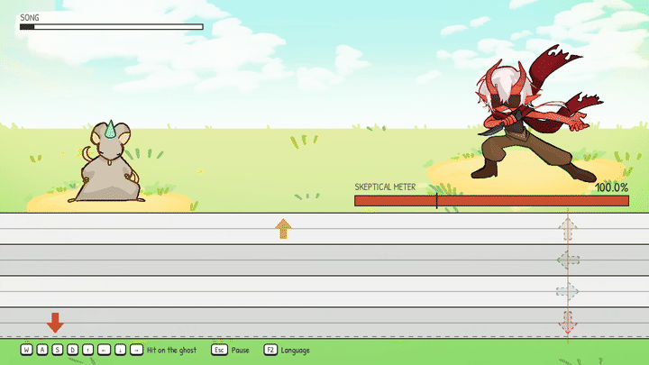
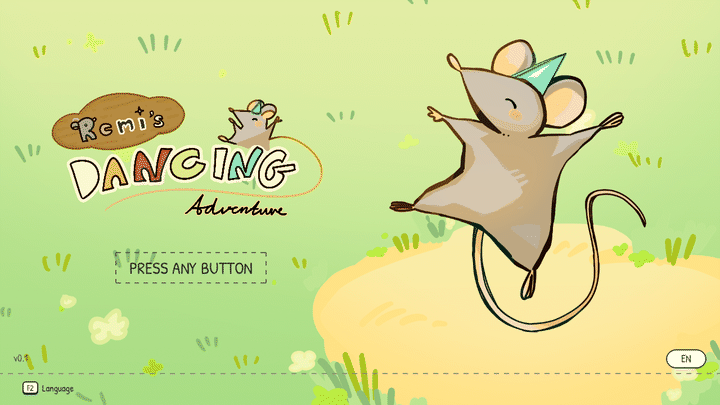
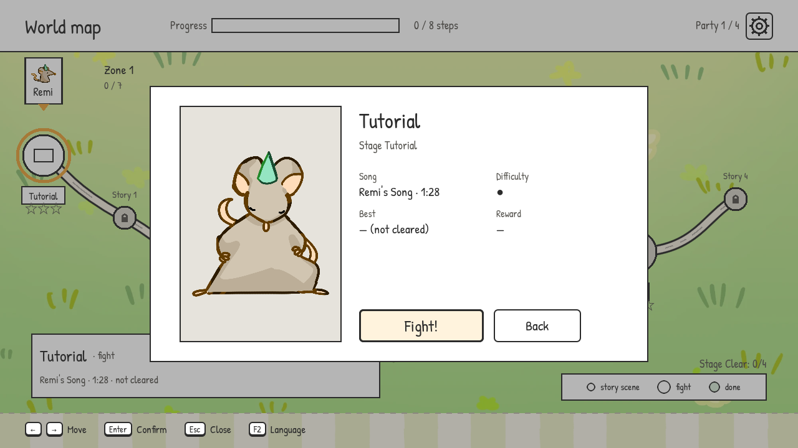
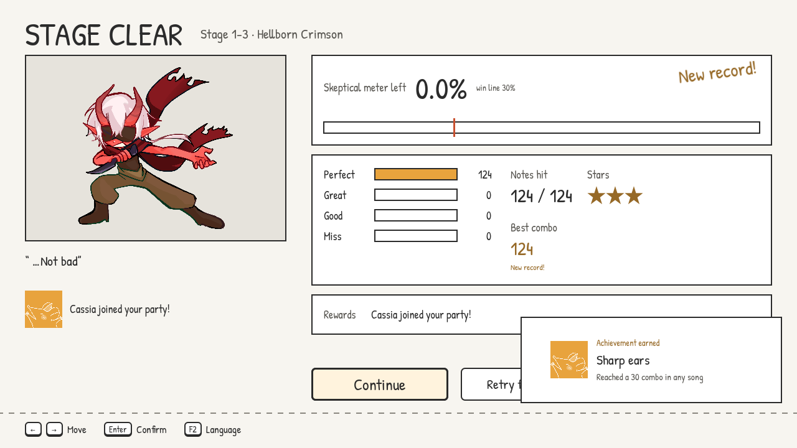
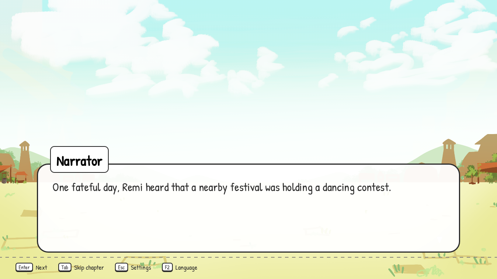
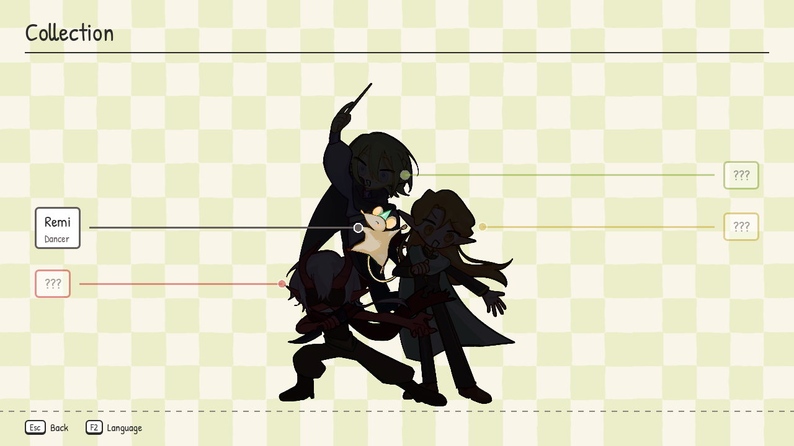
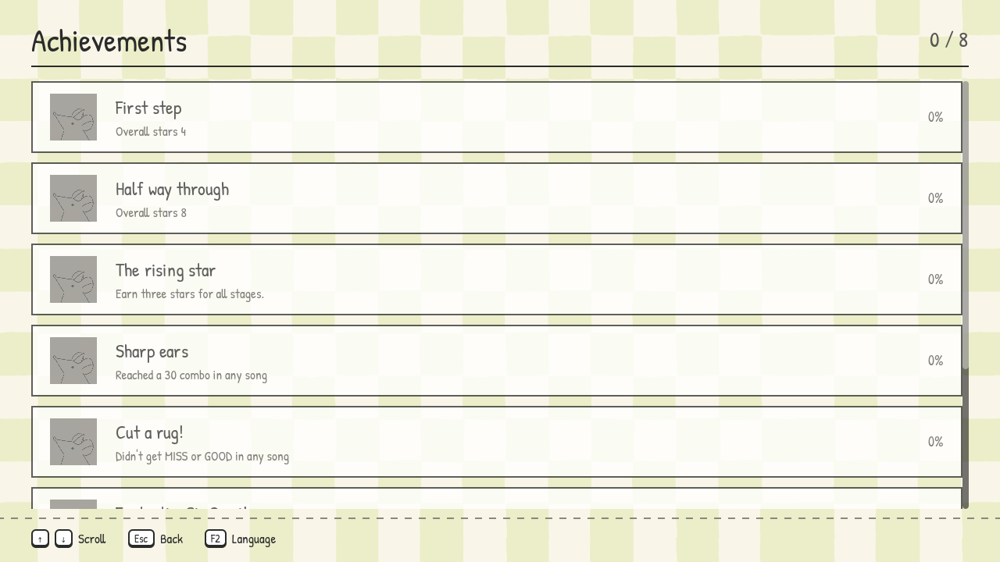
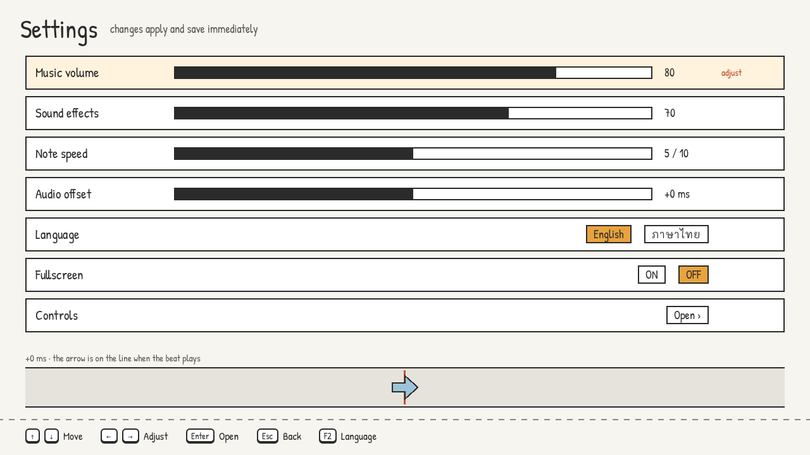
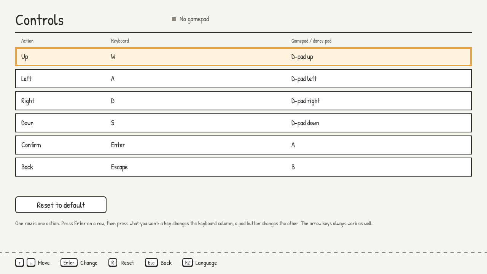

# Remi's Dancing Adventure

A four-lane rhythm game with a visual novel between the fights, built in Godot
4.7.2 for ITCS345 at Mahidol University. Remi is a rat who wants to win a
dancing contest, and the people in his way have to be convinced one song at a
time.



Notes fall down four lanes and are pressed on the line with **W A S D** or the
arrow keys. Hitting them lowers the opponent's Skeptical Meter. Drop it past
the win line before the song ends and they join you.

## Playing



Three save profiles, each with its own progress, party and achievements.



The map opens one node at a time. Story chapters and fights alternate, and a
stage's panel shows its song, length, difficulty and your best run before you
commit to it.



Every run is scored on how far the meter fell: three stars for a flawless
clear, down to none. Beating your own record is called out, and clearing a
stage can bring a new character into the party.

## The rest of it

| | |
|---|---|
|  | **Story.** Chapters play between fights, with the cast introduced as they join. Readable in English or Thai, switched with F2 at any time. |
|  | **Collection.** Everyone you have met, filling in as the party grows. |
|  | **Achievements.** Earned from how you play rather than how far you get, and announced as they happen. |
|  | **Settings.** Music and effects volume, note speed, and an input offset for machines whose audio runs late. |
|  | **Controls.** Every action rebindable, keyboard and gamepad side by side. Two lanes can never share a key. |

## Built with

Godot 4.7.2, GDScript, no external engine plugins beyond Dialogic for the
visual novel scenes. Charts are a BMS-like text format, one file per song.

## Running it

Open the project in Godot 4.7.2 and press play, or take a build from
`export/`. The tests are a set of headless scenes:

```
./tests/run.sh
```

See `tests/README.md` for what they cover.

---

The clips above are recorded by the game itself. It renders one frame at a
time while a script drives it and plays the chart note by note, so the
playthrough is flawless in a way a human would not be. The real clear rate on
that song, measured across 59 attempts by 36 playtesters, was 37%.
